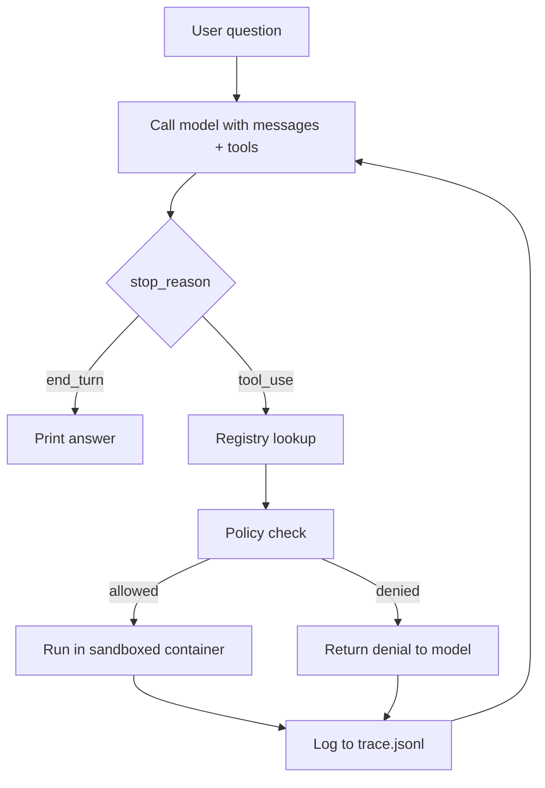

# AgentGate

A minimal LLM agent runtime that routes every tool call through a policy check and executes it in a sandboxed Docker container.

Built from scratch, without an agent framework, to understand what happens between a model *asking* for a tool and that tool actually running.

## Why

A language model can't touch your machine. When it "uses a tool," it only emits JSON asking for one — your code decides whether that request runs. AgentGate is the layer that makes that decision safely.

The core idea: **tool output is untrusted input.** If an agent reads a file containing hostile instructions, the model may be steered into requesting something it shouldn't. The policy layer has to hold even when the model has been manipulated.

## Architecture



**Agent loop** — sends the conversation to the model, executes requested tools, appends results, repeats until the model finishes. Capped at 10 iterations.

**Policy layer** — runs before any container starts:
- validates argument types
- rejects absolute paths
- resolves `..` and symlinks with `realpath`, then confirms the path is still inside the workspace
- checks the command against an allowlist (`cat`, `ls`, `wc`, `head`)

**Sandbox** — every allowed call runs in a fresh Alpine container:
- `--network=none` — no network access
- `--user 1000:1000` — non-root
- `--memory=256m` — memory cap
- workspace mounted read-only; nothing else from the host is visible
- 10-second timeout, container removed after each call

**Failure recovery** — policy denials, unknown tools, malformed arguments, timeouts, and non-zero exits all return as tool results instead of crashing, so the model can adapt.

**Trace log** — every call is appended to `trace.jsonl` with the tool, arguments, policy decision, and duration.

## Running it

Requires Python 3, Docker, and an Anthropic API key.

```bash
python3 -m venv venv
source venv/bin/activate
pip install -r requirements.txt
export ANTHROPIC_API_KEY="your-key"

mkdir -p workspace
echo "Meeting moved to Friday." > workspace/notes.txt

python3 agent.py "What's in notes.txt?"
```

## Tests

```bash
pytest -v
```

Tests use a scripted fake client instead of the real API, so they're deterministic, instant, and free. Coverage:

- allowed file read
- absolute path denied
- path traversal denied
- malformed arguments don't crash
- unknown tool doesn't crash
- iteration cap stops a runaway loop
- **prompt injection via tool output is blocked** — a file the agent is allowed to read contains instructions to read `/etc/passwd`; the scripted model follows them, and the policy layer denies the request

## Design decisions

**Allowlist, not denylist.** A denylist fails open — any dangerous command you didn't think of gets through. An allowlist fails closed.

**Policy check *and* container.** The container doesn't trust the policy check to be correct. If the check has a bug, the command still runs somewhere with no network, no root, and only the workspace visible.

**Denials return to the model.** Instead of hard-failing, a denial becomes a tool result. The model sees it and tries something else, and the boundary still holds.

**Container per call.** Each call spins up a fresh container (~300ms overhead, visible in the trace log). A long-lived container would be faster but would leak state between calls.

## Limitations

- Containers share the host kernel, so a kernel exploit could escape.
- Policy checks are called by each handler by convention; a new tool that skips them would bypass the policy layer. A decorator or central enforcement point would make this structural.
- No memory between runs — the conversation lives only for one invocation.
